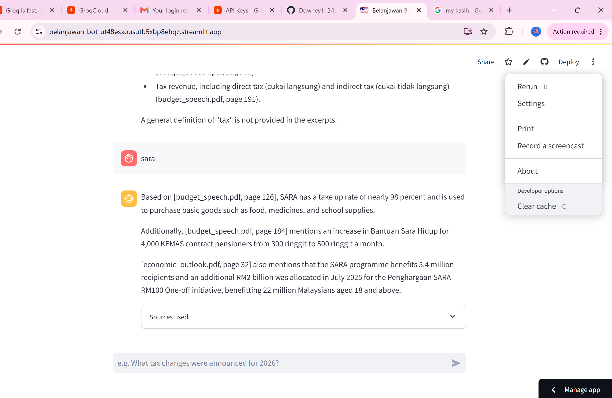
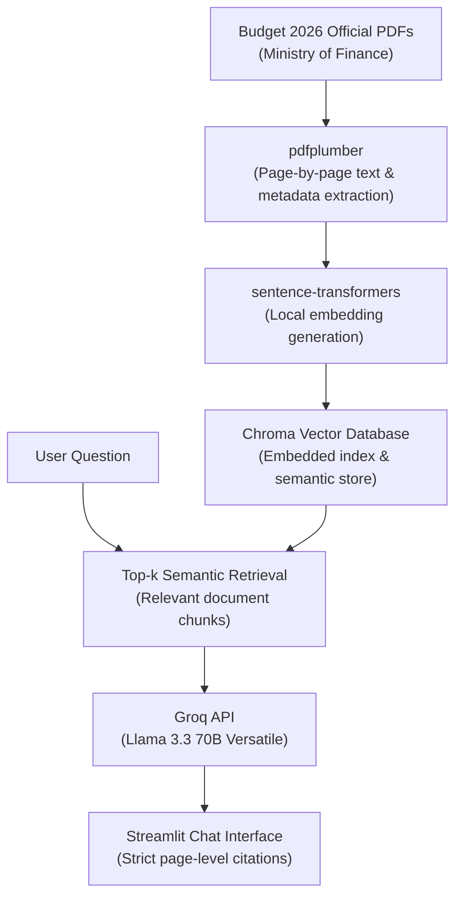

# Belanjawan Bot 🇲🇾🤖

[](https://belanjawan-bot-ut48esxousutb5xbp8ehqz.streamlit.app/)
[-F55036?style=flat)](https://groq.com)
[](https://trychroma.com)
[](https://sbert.net)

A Retrieval-Augmented Generation (RAG) system that answers questions about **Malaysia's Budget 2026 (Belanjawan 2026)**, strictly grounded in official Ministry of Finance documents — delivering verifiable, page-level citations rather than hallucinated outputs.

🔗 **Live Application:** [belanjawan-bot.streamlit.app](https://belanjawan-bot-ut48esxousutb5xbp8ehqz.streamlit.app/)



---

## ⚡ Architecture Flow



---

## 💬 Example Interaction

> **User:** What is SARA and who benefits from it?  
> **Belanjawan Bot:** Based on `[budget_speech.pdf, page 126]`, SARA has a take-up rate of nearly 98% and is used to purchase essential goods such as food, medicines, and school supplies. Additionally, `[budget_speech.pdf, page 184]` details an increase in Bantuan Sara Hidup for 4,000 KEMAS contract pensioners from RM300 to RM500 monthly. `[economic_outlook.pdf, page 32]` also confirms that the SARA programme benefits 5.4 million recipients, with an additional RM2 billion allocated in July 2025 for the Penghargaan SARA RM100 One-off initiative.

---

## 🏗️ Technical Highlights

* **Citation Integrity:** Page numbers are preserved as first-class metadata across chunking and vector storage, allowing every generated claim to cite exact source pages.
* **Zero-Cost Inference:** Utilizes lightweight local embeddings (`sentence-transformers`) paired with Groq's high-speed LPU inference running Llama 3.3 70B.
* **Grounded Guardrails:** System prompts enforce an explicit refusal state if user inquiries exceed document scope, eliminating hallucinations.

---

## ⚙️ Local Development Setup

### 1. Clone & Set Up Virtual Environment
```bash
git clone https://github.com/Downey112/belanjawan-bot.git
cd belanjawan-bot

python -m venv .venv
source .venv/bin/activate  # On Windows: .venv\Scripts\activate
pip install -r requirements.txt
```

### 2. Download Official Documents & Ingest
```bash
# Pulls Fourth MADANI Budget speech & Economic Outlook PDFs
python download_docs.py

# Builds Chroma vector database with embeddings
python ingest.py
```

### 3. Run Locally
```bash
# Set your free Groq API key (console.groq.com)
export GROQ_API_KEY="gsk_..."  # Windows: $env:GROQ_API_KEY="gsk_..."

streamlit run app.py
```
