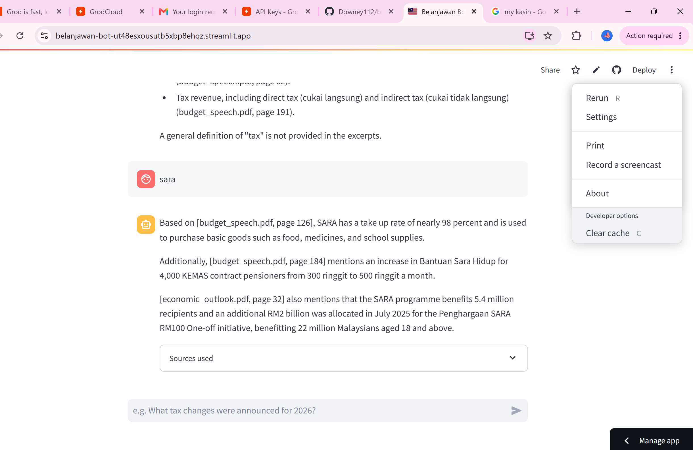
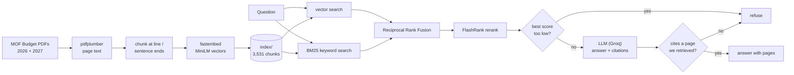

# Belanjawan Bot 🇲🇾🤖

[](https://github.com/Downey112/belanjawan-bot/actions/workflows/ci.yml)
[](https://belanjawan-bot-ut48esxousutb5xbp8ehqz.streamlit.app/)
[-F55036?style=flat)](https://groq.com)

Ask questions about **Malaysia's Budget 2026 and Budget 2027** and get answers taken only from the
official Ministry of Finance documents, with the page each fact came from. If the documents don't
answer the question, the bot says so instead of guessing.

🔗 **Live app:** [belanjawan-bot.streamlit.app](https://belanjawan-bot-ut48esxousutb5xbp8ehqz.streamlit.app/)
· **Eval results:** [EVAL.md](EVAL.md) · **Design decisions:** [EXPLAIN.md](EXPLAIN.md)



## Results

Measured on a golden set of 34 questions whose answer page is known, plus 6 off-topic questions
(`eval/golden.jsonl`). "recall@5" = the right page is in the top 5 results.

| Search mode | hit@1 | recall@5 | MRR@10 |
|---|---|---|---|
| vector only (v1 of this app) | 0.324 | 0.794 | 0.506 |
| keyword (BM25) | 0.559 | 0.912 | 0.732 |
| hybrid (RRF of both) | 0.471 | 0.941 | 0.668 |
| **hybrid + rerank (default)** | **0.559** | **0.971** | **0.749** |

CI re-runs this on every pull request and fails if any mode drops by more than 0.03.
Caveat: most golden questions reuse the documents' own wording, which flatters keyword search.

## How it works



- **Retrieval** (`belanjawan/retrieve.py`): vector search catches paraphrases, BM25 catches exact
  figures and acronyms (RM amounts, SARA, STR, SJKP). They are merged by rank (RRF), then a small
  cross-encoder reranks the top 30.
- **Guardrails** (`belanjawan/generate.py`): refuse before calling the LLM when nothing relevant is
  found; drop any citation that points at a page we did not retrieve; refuse an answer that cites
  nothing.
- **Serving**: Streamlit chat (`app.py`) and a FastAPI service (`belanjawan/api.py`) share the same code.
- **Optional Postgres backend** (`belanjawan/pgstore.py`): the same search with pgvector (HNSW) and
  Postgres full-text search, tested in CI against a pgvector container.

## Run it

```bash
git clone https://github.com/Downey112/belanjawan-bot.git && cd belanjawan-bot
python -m venv .venv && source .venv/bin/activate      # Windows: .venv\Scripts\activate
pip install -r requirements-dev.txt
export GROQ_API_KEY="gsk_..."                         # free at console.groq.com

streamlit run app.py                                  # chat UI
uvicorn belanjawan.api:app --reload                   # API, docs at http://127.0.0.1:8000/docs
pytest -q                                             # tests
python eval/run_retrieval.py                          # retrieval eval (no key needed)
python eval/run_answers.py                            # end-to-end answer eval (needs the key)
python ingest.py                                      # rebuild index/ (downloads the PDFs)
```

Docker: `docker build -t belanjawan-bot . && docker run -p 8000:8000 -e GROQ_API_KEY=... belanjawan-bot`

```bash
curl -X POST localhost:8000/v1/search -H "Content-Type: application/json" \
     -d '{"question": "How much SARA aid do STR recipients get?", "year": 2027, "k": 3}'
```

## Limits

- Text only: tables and two-column pages (Economic Outlook chapters) extract out of order.
- The embedding model is English-only; Malay questions rely on keyword search.
- The golden set has no Budget 2026 questions and no multi-page questions yet.

## License

[MIT](LICENSE)
